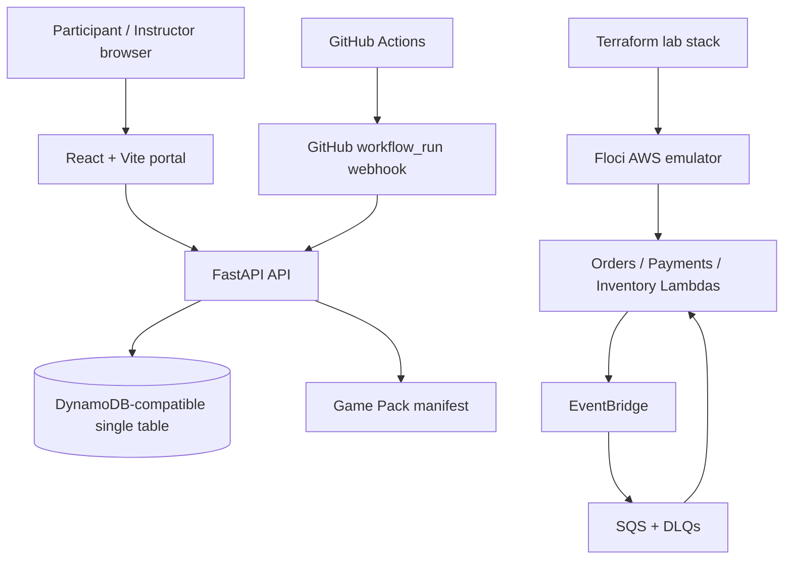

# Architecture overview

## Product boundaries

CloudOps Arena is split into a **control plane**, a **Game Pack catalog**, and **lab providers**.

- Control plane: event lifecycle, participants, teams, sessions, missions, progress, submissions, scoring and audit data.
- Game Pack: declarative content and versioned workshop-specific assets.
- Provider adapter: connectivity and capabilities for a lab target (Floci, AWS sandbox, future emulators/providers).
- Provisioning/execution runner: applies reviewed infrastructure plans and runs tests in a constrained environment. It is deliberately separated from the public API.

## Current MVP topology

## Game Pack contract

A Game Pack is a versioned directory containing `manifest.yaml`, optional mission content, validators, incident definitions, functions and infrastructure. The engine interprets the manifest and must not contain workshop-specific conditional logic.

Core fields in v1:

- `id`, `title`, `version`, `difficulty`, `duration_minutes`.
- `team.min_members`, `team.max_members`.
- `technologies`.
- `scoring.total_points`, `scoring.bonus_points`.
- `missions[]`: IDs, types, categories, instructions, points and validation metadata.
- `github_workflows`: trusted workflow path → mission ID mappings.

The API strips answer keys and validator secrets before returning mission content to a participant.

## Lab provider contract

`apps/api/app/providers/base.py` defines a small interface and status model. The current `FlociProvider` and `AwsSandboxProvider` adapters implement **connectivity/capability checks only**. They do not yet orchestrate Terraform processes. This is intentional: provisioning code will be added to a separate runner service, not to the web API.

Recommended provider lifecycle for the next iteration:

1. `preflight`: check provider health, quotas, available capacity and pack compatibility.
2. `provision`: execute only a reviewed, version-pinned Game Pack plan.
3. `validate`: run provider-specific smoke tests and persist evidence.
4. `reset`: restore a known state between attempts if the pack supports it.
5. `destroy`: remove lab resources and verify no billable resources remain.

## Data model

The local MVP uses a DynamoDB single-table key pattern:

| PK | SK | Record |
|---|---|---|
| `EVENT#{eventId}` | `META` | Event metadata and active mission |
| `EVENT#{eventId}` | `TEAM#{teamId}` | Team, capacity, score and GitHub repository binding |
| `EVENT#{eventId}` | `USER#{participantId}` | Participant membership |
| `EVENT#{eventId}` | `SUB#{teamId}#{missionId}` | Idempotent mission completion and scoring evidence |

For small workshops, scans are acceptable for the current MVP. Before using this as a large multi-tenant service, add indexes for event-code lookup, event listing, repo-to-team lookup, score ordering and audit history; avoid unbounded scans in hot paths.

## Scoring model

Mission scoring is awarded by an atomic DynamoDB transaction:

- Conditional insert of a unique team/mission submission.
- Increment of the team's score in the same transaction.

This prevents duplicate GitHub deliveries or repeated submissions from awarding points twice.

## Realtime model

The current UI refreshes on demand. For larger GameDays, implement API Gateway WebSocket or AppSync subscriptions for leaderboard and mission state, or conservative polling with jitter and ETags. Do not have hundreds of browsers poll DynamoDB directly.
