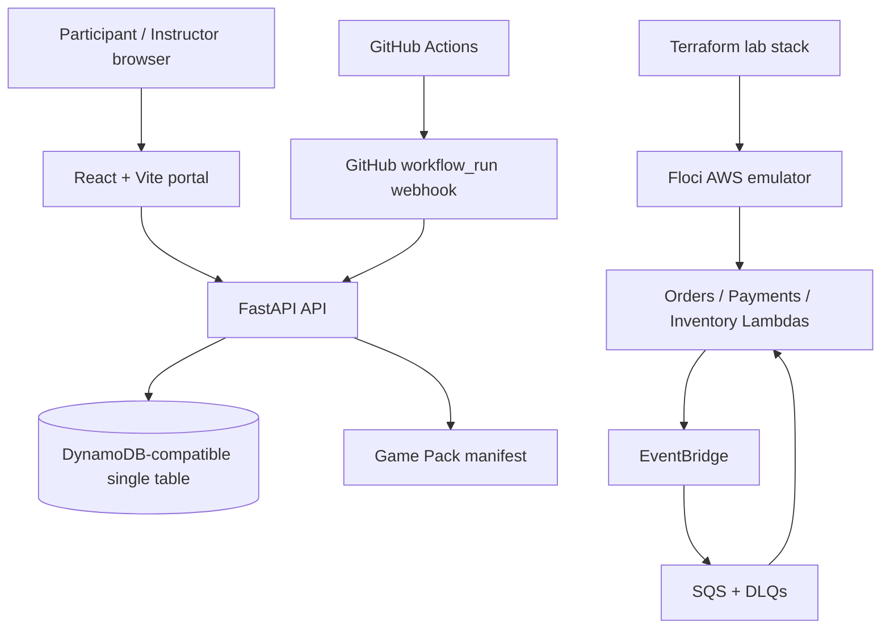

# Architecture overview

## Product boundaries

CloudOps Arena is split into a **control plane**, a **Game Pack catalog**, and **lab providers**.

- Control plane: event lifecycle, participants, teams, sessions, missions, progress, submissions, scoring and audit data.
- Game Pack: declarative content and versioned workshop-specific assets.
- Provider adapter: connectivity and capabilities for a lab target (Floci, AWS sandbox, future emulators/providers).
- Provisioning/execution runner: applies reviewed infrastructure plans and runs tests in a constrained environment. It is deliberately separated from the public API.

## Current MVP topology

## Game Pack contract

A Game Pack is a versioned directory containing `manifest.yaml`, optional mission content, validators, incident definitions, functions and infrastructure. The engine interprets the manifest and must not contain workshop-specific conditional logic.

Core fields in v1:

- `id`, `title`, `version`, `difficulty`, `duration_minutes`.
- `team.min_members`, `team.max_members`.
- `technologies`.
- `scoring.total_points`, `scoring.bonus_points`.
- `missions[]`: IDs, types, categories, instructions, points and validation metadata.
- `github_workflows`: trusted workflow path → mission ID mappings.

The API strips answer keys and validator secrets before returning mission content to a participant.

## Lab provider contract

`apps/api/app/providers/base.py` defines a small interface and status model. The current `FlociProvider` and `AwsSandboxProvider` adapters implement **connectivity/capability checks only**. They do not yet orchestrate Terraform processes. This is intentional: provisioning code will be added to a separate runner service, not to the web API.

Recommended provider lifecycle for the next iteration:

1. `preflight`: check provider health, quotas, available capacity and pack compatibility.
2. `provision`: execute only a reviewed, version-pinned Game Pack plan.
3. `validate`: run provider-specific smoke tests and persist evidence.
4. `reset`: restore a known state between attempts if the pack supports it.
5. `destroy`: remove lab resources and verify no billable resources remain.

## Data model

Workshop experience adds event mission deadlines and pause snapshots, a
`WALLET#team` spending counter and unique `HINT#team#mission#hint` receipts.
Earned coins derive from unique verified mission completions; neither browser
claims nor retries increment them. Hint debits atomically fence spending,
membership, active mission and server deadline. Public mission payloads omit
hint text; the participant dashboard reveals only the current team's purchases.

The manager's `owners` table now counts participant/team slots independently of
VM generations. A current lab remains until a replacement's canonical deployment
receipt commits; authenticated receipt reconciliation then activates the new lab
and retires older generations. Failed attempts do not consume another owner
slot. Shutdown drains active handlers before releasing the manager. See
[schema, behavior and validation](workshop-experience.md).

The local MVP uses a DynamoDB single-table key pattern:

| PK | SK | Record |
|---|---|---|
| `EVENT#{eventId}` | `META` | Event metadata and active mission |
| `EVENT#{eventId}` | `TEAM#{teamId}` | Team, capacity, score and GitHub repository binding |
| `EVENT#{eventId}` | `USER#{participantId}` | Participant membership |
| `EVENT#{eventId}` | `SUB#{teamId}#{missionId}` | Idempotent mission completion and scoring evidence |
| `EVENT#{eventId}` | `EVAL#{evaluationId}` | Pending delivery with participant, repository, commit SHA, mission and pack version |
| `EVENT#{eventId}` | `EVALLOCK#{teamId}` | One outstanding evaluation per individual/team leaderboard entry |

Evaluation registration uses one DynamoDB transaction to check the event is open,
the mission is active, the participant is still a member, the repository binding
is unchanged and the mission is not complete; then inserts the request and its
exclusive slot. The identity is deterministic from team, mission, pack/version,
repository and commit. Duplicate requests return the existing record. Existing
events require no data migration; records are inserted on evaluation requests.

The default worker claims records with a 120-second lease, checks public GitHub commit
metadata and required files, and records failed/blocked results while releasing the
slot atomically. Expired leases are recovered as blocked. Conditional retries are
limited to five attempts per delivery. See [evaluations.md](evaluations.md).
The evaluator Compose override adds authorized KVM plan grading for mission 02,
with ten-minute leases, a networkless disposable VM, trusted source/evidence checks
and atomic scoring. Cancellation and later mission runtime execution remain pending.

The request endpoint does not dispatch GitHub Actions or execute any code. The
repository ownership is verified through GitHub App OAuth and scoped installation
access before VM execution. Default preflight never interprets file presence as
success. The executor has no storage/API keys or host Docker socket. See
[the runner guide](github-app-and-runner.md) for the source and evidence boundaries.

For small workshops, scans are acceptable for the current MVP. Before using this as a large multi-tenant service, add indexes for event-code lookup, event listing, repo-to-team lookup, score ordering and audit history; avoid unbounded scans in hot paths.

## Scoring model

Mission scoring is awarded by an atomic DynamoDB transaction:

- Conditional insert of a unique team/mission submission.
- Increment of the team's score in the same transaction.

This prevents duplicate GitHub deliveries or repeated submissions from awarding points twice.

## Realtime model

The participant UI polls the dashboard every five seconds to discover deliveries
requested from Actions. An active delivery also opens an authenticated SSE stream
with curated stage snapshots, one-second change checks and 55-second reconnects.
The runner streams root-owned VM stage codes to the worker over its internal
connection; only the official final result can award points. For larger GameDays, implement API Gateway WebSocket or
AppSync subscriptions, or polling with jitter and ETags. Browsers must use the API
rather than query DynamoDB directly.

## Bounded execution for 50 participants

The optional `compose.playgrounds.yaml` integration adds a private persistent lab
manager. Authenticated participant routes derive the lab digest from current
event/membership; the browser never chooses a VM/account/SDK endpoint. The manager
stores FIFO/state/curated snapshots in SQLite on `playground-work`, creates a
separate KVM disk per leaderboard entry, and parks each VM after its operation.
Only the trusted reference template runs in this version; GitHub submissions and
scoring retain their existing evaluator path. Locks in `vm-slots` bound the
combined evaluator/playground fleet to two VMs, independently of their local
thread pools. There is no combined FIFO across these two queues yet.

The participant-facing reference flow is withdrawn. Mission-02 Actions now has
separate plan/deploy operations. Plan cannot score; deploy mounts verified commit
files in a dedicated persistent VM and checks inventory after reboot. The worker
atomically writes `DEPLOY#{teamId}` with completion/points, rechecking lease and
ownership. Participant GET requires that receipt plus matching manager provenance;
without it, it returns `awaiting_deployment`. Portal POST cannot provision a
reference template. See [mission-02 deploy](mission-02-deploy.md).

The manager authenticates private API event-state checks and expires labs on
event finish or their two-hour TTL. Read APIs recheck membership and event state
before returning snapshots. SQLite and local disks require a single manager
replica; this is not an HA scheduler. See [deployment and evidence](playgrounds.md).

The edge defaults now admit 50 outstanding evaluations globally and run two VMs
through a thread pool and an independent executor admission gate. A transactional
counter tracks queued/active work; queued_at orders dispatch, retries join at
the back, unavailable infrastructure requeues work and queue wait expires after
30 minutes. Persistent playground execution uses the separate manager described
above; the existing evaluator does not deploy participant code into those labs.
[Capacity and validation](capacity-50.md).
